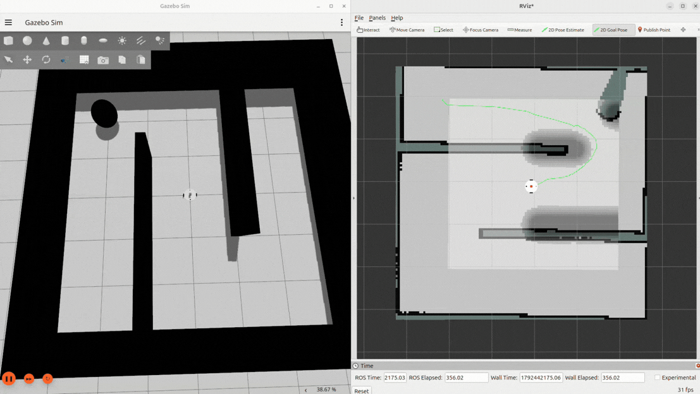
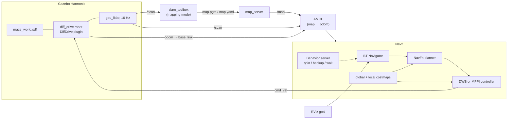
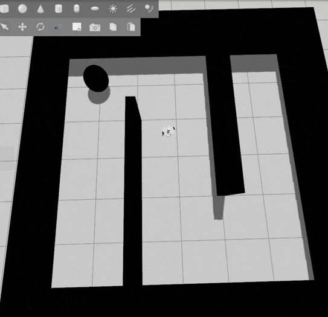
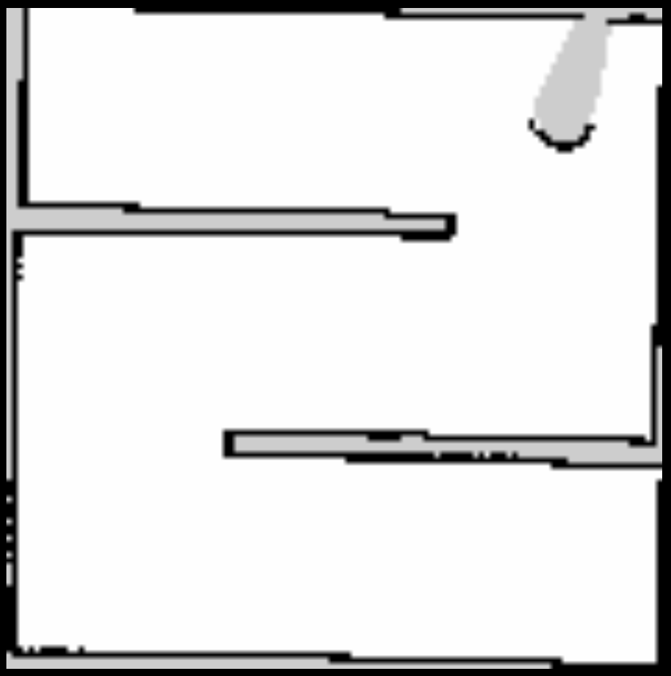

# Autonomous Navigation of a Differential-Drive AMR: ROS 2 Jazzy · Gazebo Harmonic · Nav2


> LiDAR-only SLAM → saved occupancy grid → AMCL localization → Nav2 goal navigation for a
> differential-drive robot in a custom Gazebo maze, with two local-controller profiles (DWB baseline, MPPI)
> and a documented root-cause analysis of every failure I ran into along the way.

**Scope statement.** This is a simulation project. Every quantitative statement below is one of:
a configuration fact, a value derived analytically from the configuration, or an observation from
runtime logs. I make no benchmark claims; the measurements still to be collected are listed
in [§7](#7-validation-status).

---

## 1. Overview

The robot is a 0.30 m-track differential-drive platform, described in URDF/Xacro and simulated in Gazebo Harmonic
inside a 6 × 6 m maze with an S-shaped corridor. The runtime is a classic three-layer pipeline:
`slam_toolbox` builds the map once; Nav2's AMCL then localizes against it by publishing `map → odom`
on top of the simulator's `odom → base_link`; and a Nav2 stack (NavFn global planner, layered
costmaps, DWB or MPPI local controller, behavior-tree orchestration) turns RViz goals into velocity
commands.

### Engineering highlights

- **End-to-end pipeline, reproducible from a clean checkout.** Simulation, mapping, localization and
  navigation are separate launch units with a defined start-up order.
- **Root-caused a full localization outage to simulator configuration**, not to the localizer. The
  `Sensors` system was declared at sensor scope instead of world scope, so no scan was ever produced,
  so `map → odom` never existed, so Nav2 never activated ([§6.1](#61-failure-log)).
- **Diagnosed the DWB stall from critic telemetry.** Goal-distance terms contributed ≈ 95 % of the
  trajectory cost and the whole candidate set spanned < 10 % in score, which is a flat cost landscape that
  rewards creeping ([§6.2](#62-case-study-dwb-stall-at-the-wall-tip)). I then migrated to MPPI
  (1000 rollouts × 56 steps at 20 Hz).
- **Footprint-consistent costmap tuning derived from the URDF** (0.16 m circumscribed radius →
  0.18 m `robot_radius`), with the inflation profile worked out analytically rather than by trial and
  error ([§5.2](#52-costmaps)).
- **Checked the textbook against the implementation.** Nav2's AMCL likelihood-field model combines beams
  as `1 + Σ pₖ³`, not a product, which bounds the best-to-worst particle weight ratio at ≈ 11 : 1 for
  this sensor configuration ([§4.3](#43-amcl)).
- **Explicit non-claims.** There is no EKF/IMU fusion, no kidnapped-robot benchmark and no dynamic-obstacle
  prediction. Each is stated, justified and listed as a roadmap item.

### System at a glance

Autonomous navigation demo


*[PLACEHOLDER: High-frame-rate demo GIF, RViz + Gazebo side by side, start → goal]*

<details>
<summary>Text version of the architecture (renders on GitHub)</summary>


</details>

---

## 2. Technology stack

| Layer | Component | Version / configuration | Purpose |
|---|---|---|---|
| Environment | OS / middleware | Ubuntu 24.04, ROS 2 Jazzy | Platform; lifecycle nodes, TF2, launch |
| | Simulator | Gazebo Harmonic (`gz sim`) | Physics, GPU LiDAR, diff-drive odometry |
| | Client libraries | Python 3 (`ament_python`, launch files); Nav2 plugins in C++ | Orchestration; algorithm plugins |
| Description | Robot / world | URDF-Xacro (`urdf/`), SDF world (`worlds/maze_world.sdf`) | Kinematics, sensor model, test arena |
| Mapping | SLAM | `slam_toolbox`, online-async, Ceres (Levenberg–Marquardt) | Pose-graph SLAM with loop closure |
| Localization | Engine | Nav2 AMCL, `DifferentialMotionModel`, likelihood-field sensor model | `map → odom` from particle filter |
| | State estimation | Simulator wheel odometry only (no EKF), see [§4.2](#42-state-estimation-scope) | `odom → base_link` |
| Navigation | Global planner | `nav2_navfn_planner::NavfnPlanner` (Dijkstra) | Cost-aware path on the global grid |
| | Local controllers | `dwb_core::DWBLocalPlanner` (`nav.yaml`) · `nav2_mppi_controller::MPPIController` (`nav_mppi.yaml`) | Velocity commands |
| | Costmaps | `StaticLayer`, `ObstacleLayer`/`VoxelLayer`, `InflationLayer` | Collision/cost representation |
| | Orchestration | BT Navigator, Behavior Server (`spin`, `backup`, `drive_on_heading`, `wait`, `assisted_teleop`) | Replanning and recovery |

---

## 3. Robot, world and TF topology

### 3.1 Robot profile (`urdf/nav2_mobile_robot.xacro`, `urdf/nav2_mobile_robot_macro.xacro`)

| Element | Specification |
|---|---|
| `base_link` | Cylinder, R = 0.15 m, h = 0.02 m, m = 5 kg; collision = visual geometry |
| Drive wheels | Two `continuous` joints about Y at (0, ±0.15, 0); r = 0.039 m, width 0.02 m, m = 2.5 kg each; **track L = 0.30 m** |
| Casters | Two passive fixed spheres, r = 0.025 m, at x = +0.115 m and x = −0.135 m |
| `lidar_link` | 5 cm box on a fixed joint, sensor origin 0.07 m above `base_link` |
| Actuation | `gz::sim::systems::DiffDrive`: `cmd_vel` in; odometry and `odom → base_link` out at 10 Hz |
| Circumscribed radius | max(0.15 m base, 0.16 m wheel outer face, 0.16 m rear caster) ≈ **0.16 m**, used to size the costmap footprint ([§5.2](#52-costmaps)) |

**Kinematics.** With wheel angular velocities ω_L, ω_R, wheel radius r and track L:

$$
\begin{bmatrix} v \\ \omega \end{bmatrix}
=
\begin{bmatrix} r/2 & r/2 \\ -r/L & r/L \end{bmatrix}
\begin{bmatrix} \omega_L \\ \omega_R \end{bmatrix},
\qquad
x_{k+1}=x_k+v\,\Delta t\cos\!\left(\theta_k+\tfrac{\omega\Delta t}{2}\right),\;
y_{k+1}=y_k+v\,\Delta t\sin\!\left(\theta_k+\tfrac{\omega\Delta t}{2}\right),\;
\theta_{k+1}=\theta_k+\omega\Delta t
$$

A differential drive can rotate about its own centre, so its minimum turning radius is zero. Motion
constraints therefore reduce to speed and acceleration limits rather than a curvature bound, which is
why a grid planner is sufficient here ([§5.3](#53-global-planner)). The speed limits map to wheel rates as follows
(worst case is full forward speed combined with full yaw rate):

$$
\omega_{R}^{\max}=\frac{v_{\max}+\omega_{\max}L/2}{r}=\frac{0.26+1.0\cdot 0.15}{0.039}\approx 10.5\ \text{rad/s}
$$

That is about 100 rpm, comfortably inside the joint limit of 100 rad/s declared in the Xacro.

### 3.2 Sensors

| Sensor | Interface | Parameters |
|---|---|---|
| 2D LiDAR (`gpu_lidar`, frame `lidar_link`) | `sensor_msgs/LaserScan` on `/scan` | 10 Hz · 640 beams over ±80° (160° FOV, 0.25° pitch) · range 0.1–10 m · **single ring** (vertical samples = 1) · no noise model |
| Wheel odometry | `nav_msgs/Odometry` on `/odom` | 10 Hz · integrates commanded wheel motion; no injected noise |
| IMU | n/a | **Not present** |

I kept the scan as a true 2D ring on purpose, so that `ranges[]` is consistent with the angle metadata that
AMCL, SLAM and the costmaps assume. The 160° FOV leaves a **200° blind sector behind the robot**, which
matters for reverse motion ([§9](#9-repository-layout-limitations-and-roadmap)).

### 3.3 World

`worlds/maze_world.sdf` is a 6 × 6 m arena (0.2 m walls, 1 m high) with two staggered 4 m inner walls
forming an S-shaped corridor and a goal marker at (2, 2). The world declares the `Physics`,
`UserCommands`, `SceneBroadcaster` and `Sensors` systems. The last one **must** live at world scope for
the LiDAR to render ([§6.1](#61-failure-log)).


*[PLACEHOLDER: Gazebo screenshot of the maze with the robot at spawn]*

### 3.4 TF tree

```text
map ──► odom ──► base_link ──┬──► lidar_link
                             ├──► left_wheel / right_wheel
                             └──► passive_wheel_front_link / passive_wheel_back_link
```

| Transform | Publisher | Notes |
|---|---|---|
| `map → odom` | `slam_toolbox` **or** AMCL, never both | AMCL post-dates it by `transform_tolerance` = 1.0 s |
| `odom → base_link` | Gazebo `DiffDrive` | 10 Hz; locally smooth, drifts globally |
| `base_link → sensors/wheels/casters` | `robot_state_publisher` | Fixed joints + simulated wheel joint states |

The localizer never edits odometry. It publishes the *correction* between the two frames so that the
pose in `odom` stays continuous (needed by the local controller) while the pose in `map` stays globally
consistent (needed by the planner):

$$
T_{map\leftarrow odom}\;=\;\hat T_{map\leftarrow base}\;\bigl(T_{odom\leftarrow base}\bigr)^{-1},
\qquad
T_{map\leftarrow base}=T_{map\leftarrow odom}\,T_{odom\leftarrow base}
$$


*[PLACEHOLDER: output of `ros2 run tf2_tools view_frames`]*

---

## 4. Mapping, state estimation and localization

### 4.1 Mapping (`config/slam.yaml`)

`slam_toolbox` runs in online-asynchronous mapping mode. It performs correlative scan matching for each
keyframe and optimizes a pose graph; loop closures add edges that are solved globally:

$$
\mathbf{x}^{*}=\arg\min_{\mathbf{x}}\sum_{(i,j)\in\mathcal{E}}\bigl(\mathbf{z}_{ij}-h(\mathbf{x}_i,\mathbf{x}_j)\bigr)^{\!\top}\Omega_{ij}\bigl(\mathbf{z}_{ij}-h(\mathbf{x}_i,\mathbf{x}_j)\bigr)
$$

| Parameter | Value | Engineering rationale |
|---|---|---|
| `resolution` | 0.05 m | Robot ≈ 7 cells across; 0.2 m walls ≈ 4 cells. Fine enough to resolve the 0.2 m gaps without inflating grid size |
| `minimum_travel_distance` / `_heading` | 0.5 m / 0.5 rad | Keyframes only after real motion; bounds graph growth and avoids degenerate matches while stationary |
| `minimum_time_interval`, `throttle_scans` | 0.5 s, 1 | Caps scan-matching load at ≈ 2 Hz |
| `correlation_search_space_dimension` / `_resolution` | 0.5 m / 0.01 m | Local match window of ±0.25 m at 1 cm steps, wide enough for 10 Hz scans with 0.26 m/s motion |
| Coarse → fine angular search | ±20° at 2° → ±0.2° | Two-stage search keeps the cost low |
| `do_loop_closing`, `loop_search_maximum_distance` | true, 3.0 m | Closes loops inside the 6 m arena |
| `loop_match_minimum_response_coarse` / `_fine` | 0.35 / 0.45 | Two-gate acceptance: a loop edge must pass a coarse and a stricter fine correlation response |
| `loop_match_minimum_chain_size` | 10 | Rejects spurious loops against the immediately preceding scans |
| `solver_plugin` | Ceres, `SPARSE_NORMAL_CHOLESKY`, LM | Sparse solver suited to pose-graph structure |

**Map artifact.** `map/map.pgm` + `map/map.yaml`: 118 × 119 cells at 0.05 m (≈ 5.9 × 5.95 m), origin
(−3.259, −3.243). The map server converts pixels to occupancy as

$$
p=\frac{255-\text{pixel}}{255},\qquad
\text{occupied if } p>0.65,\quad \text{free if } p<0.196,\quad \text{otherwise unknown}.
$$


*[PLACEHOLDER: `map.pgm` exported as PNG, optionally overlaid on the Gazebo ground truth]*

### 4.2 State estimation scope

Odometry is the simulator's integrated wheel motion with no noise model and there is no IMU, so a
`robot_localization` EKF would have nothing to fuse. I **deliberately did not add one**. Odometry error
is instead absorbed where it actually matters, in AMCL's motion-noise parameters ([§4.3](#43-amcl)).
Introducing sensor noise (wheel slip, gyro bias) and an EKF is a roadmap item, not a claim.

### 4.3 AMCL (`config/amcl.yaml`)

AMCL approximates the Bayes filter with a particle set $\{x^{[i]}, w^{[i]}\}_{i=1}^{N}$:

$$
bel(x_t)=\eta\;p(z_t\mid x_t,m)\int p(x_t\mid x_{t-1},u_t)\,bel(x_{t-1})\,dx_{t-1}
$$

**Prediction: rotate / translate / rotate odometry model.** From the odometry increment:

$$
\delta_{rot1}=\operatorname{atan2}(\Delta y,\Delta x)-\bar\theta,\quad
\delta_{trans}=\sqrt{\Delta x^2+\Delta y^2},\quad
\delta_{rot2}=\Delta\bar\theta-\delta_{rot1}
$$

Each particle receives an independently perturbed copy, with variances set by α₁…α₄:

$$
\hat\delta_{rot1}=\delta_{rot1}-\mathcal N\!\bigl(0,\,\alpha_1\delta_{rot1}^2+\alpha_2\delta_{trans}^2\bigr),\quad
\hat\delta_{trans}=\delta_{trans}-\mathcal N\!\bigl(0,\,\alpha_3\delta_{trans}^2+\alpha_4(\delta_{rot1}^2+\delta_{rot2}^2)\bigr)
$$

With all α = 0.2, one 0.25 m update diffuses particles by σ ≈ √(0.2·0.25²) ≈ **0.11 m** along-track and
**0.11 rad (6.4°)** in heading. That is the spread the next scan has to resolve.

**Correction: likelihood field.** A distance map $d(x,y)$ (distance to the nearest occupied cell, capped
at `laser_likelihood_max_dist` = 2 m) is precomputed once, which replaces a ray-cast per beam per particle by a
table lookup. For particle pose $(x,y,\theta)$ and beam $k$ with range $r_k$ and bearing $\beta_k$:

$$
x^{hit}_k=x+r_k\cos(\theta+\beta_k),\quad
y^{hit}_k=y+r_k\sin(\theta+\beta_k),\quad
p_k=z_{hit}\,e^{-d_k^2/2\sigma_{hit}^2}+\frac{z_{rand}}{r_{max}}
$$

I checked the combination rule against the Nav2 source: beams are **not** multiplied. Instead, the particle's
weight is scaled by

$$
w^{[i]}\leftarrow w^{[i]}\cdot\Bigl(1+\sum_{k=1}^{60}p_k^{3}\Bigr)
$$

This is a deliberately soft, ad-hoc scheme that compensates for the (false) independence of neighbouring beams.
For this project's values (z_hit = z_rand = 0.5, σ_hit = 0.2, r_max = 10 m) the per-beam score is:

| Endpoint distance to wall $d$ | 0 | 0.1 m | 0.2 m | 0.5 m | ≥ 1 m |
|---|---|---|---|---|---|
| $p_k$ | 0.550 | 0.491 | 0.353 | 0.072 | 0.050 |

So a perfect 60-beam match scores $1+60\cdot0.55^3\approx 11.0$ against $\approx1.01$ for a complete mismatch:
**the sensor model can never down-weight a particle by more than ≈ 11 : 1 per update.** That bound is why
σ_hit should not be tightened casually. A sharper model with a sparse particle cloud risks losing the true
hypothesis between particles.

**Resampling and adaptive size.** Low-variance resampling runs every update; the particle count follows
KLD-sampling so that the K-L divergence to the true posterior stays below ε with confidence set by $z_{1-\delta}$:

$$
N=\frac{k-1}{2\varepsilon}\Bigl\{1-\frac{2}{9(k-1)}+\sqrt{\frac{2}{9(k-1)}}\,z_{1-\delta}\Bigr\}^{3},
\qquad \varepsilon=\texttt{pf\_err}=0.05,\; z_{1-\delta}=\texttt{pf\_z}=0.99,\; k=\#\text{occupied pose bins}
$$

| Parameter | Value | Trade-off |
|---|---|---|
| `min_particles` / `max_particles` | 500 / 2000 | 60 beams × 2000 particles = 120 k table lookups per update, which is cheap enough to keep the upper bound high for a 35 m² map |
| `update_min_d` / `update_min_a` | 0.25 m / 0.2 rad | At 0.26 m/s the filter updates at most once per ≈ 0.96 s on straight runs (0.2 s in pure rotation). Lowering `update_min_d` to ≈ 0.1 m would cut pose latency ~2.5× at proportional CPU cost |
| `laser_model_type` | `likelihood_field` | No per-particle ray casting; tolerant to small map error (see σ_hit bound above) |
| `max_beams` | 60 of 640 | ≈ every 11th beam; decorrelates adjacent returns and bounds cost |
| `sigma_hit` | 0.2 m | = 4 map cells; absorbs map discretization and pose error of the nearest particle |
| `transform_tolerance` | 1.0 s | Post-dated `map → odom` so consumers tolerate scheduling jitter |

All values other than the frame IDs equal Nav2's defaults. The engineering work was establishing, from
the source and from the sensor geometry, that those defaults are consistent with this robot.

### 4.4 Initialization and the kidnapped-robot problem

`set_initial_pose: true` seeds a Gaussian cloud at (0, 0, 0), which equals the Gazebo spawn pose, so no
RViz pose click is needed. When the robot's position is genuinely unknown, uniform global localization
is triggered with the `/reinitialize_global_localization` service (particles drawn uniformly over free
cells, θ ~ U(−π, π)); the robot must then be driven so that successive scans disambiguate the symmetric
corridor.

Augmented-MCL recovery (random-particle injection) is **configured but disabled**
(`recovery_alpha_slow = recovery_alpha_fast = 0`). When enabled, the injection probability is

$$
w_{slow}\mathrel{+}=\alpha_{slow}(w_{avg}-w_{slow}),\quad
w_{fast}\mathrel{+}=\alpha_{fast}(w_{avg}-w_{fast}),\quad
P_{rand}=\max\bigl(0,\,1-w_{fast}/w_{slow}\bigr)
$$

I left it off because injected particles in a repetitive corridor can themselves capture the filter;
enabling it requires the recovery experiment listed in [§7](#7-validation-status).

---

## 5. Navigation stack

### 5.1 Orchestration

Nav2 servers are lifecycle nodes brought up by a lifecycle manager (`unconfigured → inactive → active`,
with a bond heartbeat per node). The BT Navigator replans at 1 Hz while the controller executes at
20 Hz (MPPI profile). Because the local costmap needs `base_link` in its frame at activation, **start-up
order is a correctness requirement**: simulation → localization → navigation.

### 5.2 Costmaps

| | Global costmap | Local costmap |
|---|---|---|
| Frame / window | `map`, full map (118 × 119) | `odom`, rolling 4 × 4 m (80 × 80 cells) |
| Layers (in order) | Static → Obstacle → Inflation | Voxel → Inflation |
| Update rate | 1 Hz | 10 Hz |
| Purpose | Global planning | Reactive control |

Layers write into one master grid; each non-static layer combines with `max`, so a live scan can add
obstacles but cannot erase walls of the static map. The obstacle layer marks scan endpoints and clears
free space by ray-tracing (Bresenham) up to `raytrace_max_range`. The local costmap runs in `odom`
because that frame never jumps when AMCL corrects `map → odom`; a local grid stored in `map` would
visibly shift obstacles on every correction. With a single-ring LiDAR at z = 0.07 m, the voxel layer
(16 voxels × 5 cm = 0.8 m of height) degenerates to a 2D layer. I kept it for parity with a future 3D sensor.

**Inflation profile.** For distance $d$ to the nearest obstacle, inscribed radius $r_i$, inflation radius $R$
and decay $k$ (cost classes: 254 lethal, 253 inscribed):

$$
c(d)=\begin{cases}254 & d=0\\ 253 & 0<d\le r_i\\ 252\,e^{-k\,(d-r_i)} & r_i<d\le R\\ 0 & d>R\end{cases}
$$

The footprint is a circle of radius 0.18 m (= 0.16 m circumscribed radius from the URDF + 2 cm margin).
Previously `robot_radius` was 0.22 m, which over-blocked the corridor by 4 cm per side; and an early
configuration with $R < r_i$ left a band where the costmap reported free space while the body overlapped
the wall (hence Nav2's *inflation radius smaller than inscribed radius* warning).

| Cost at $d$ | 0.20 m | 0.25 m | 0.30 m | 0.40 m |
|---|---:|---:|---:|---:|
| Baseline ($r_i$ = 0.22, $R$ = 0.30, $k$ = 3) | 253 | 230 | 198 | 0 |
| Final ($r_i$ = 0.18, $R$ = 0.40, $k$ = 5) | 228 | 178 | 138 | 84 |

The baseline has an 8 cm gradient ending in a cliff (198 → 0), which gives the planner no signal to leave the
wall. The final profile pairs a thinner solid band with a longer, steeper gradient.


*[PLACEHOLDER: RViz with global and local costmaps (colour scheme `costmap`) and the inflation gradient visible]*

### 5.3 Global planner

`NavfnPlanner` (Dijkstra, `use_astar: false`) computes a cost-to-go over the global grid and extracts the
path by gradient descent from the robot to the goal:

$$
P(n)=\min_{m\in\mathcal N(n)}\bigl(P(m)+c(n)\bigr),\quad P(\text{goal})=0,
\qquad c(n)=f\bigl(\text{costmap}(n)\bigr)\ \text{monotone increasing}
$$

My reasoning: the grid is only ≈ 14 k cells and the robot is holonomic in heading (zero turning radius), so
a lattice or Hybrid-A\* planner would add configuration-space complexity (SE(2) state, motion
primitives) with no kinematic payoff. A planner such as Smac becomes the right choice for a car-like
base or a footprint much larger than a circle.

### 5.4 Local control

**Kinematic constraints.** The limits below are shared by the controller, the velocity smoother and the
wheel-rate budget of [§3.1](#31-robot-profile-urdfnav2_mobile_robotxacro-urdfnav2_mobile_robot_macroxacro):

| Limit | Value | Source of the number |
|---|---|---|
| `vx_max` / `vx_min` | 0.26 / −0.10 m/s (MPPI) | Caps wheel rate at ≈ 10.5 rad/s; small reverse for backing out of corners |
| `wz_max` | 1.0 rad/s | In-place rotation needs only ±3.85 rad/s per wheel |
| `ax_max` / `az_max` | 2.5 m/s² / 3.2 rad/s² | Same envelope as the velocity smoother |

#### DWB (baseline, `config/nav.yaml`)

DWB samples 20 × 20 = 400 constant-velocity pairs, simulates each for `sim_time` = 1.7 s
(`x ← x + v cosθ Δt`, `y ← y + v sinθ Δt`, `θ ← θ + ωΔt`) and ranks them by a weighted sum of critics,
discarding any trajectory that touches an inscribed or lethal cell:

$$
J(\tau)=\sum_{k}s_k\,c_k(\tau),\qquad \tau^{*}=\arg\min_{\tau\ \text{valid}}J(\tau)
$$

Critics: `RotateToGoal`, `Oscillation`, `BaseObstacle`, `PathAlign`, `PathDist`, `GoalAlign`, `GoalDist`.

#### MPPI (recommended, `config/nav_mppi.yaml`)

MPPI keeps a nominal control sequence $U=(u_0,\dots,u_{T-1})$ and, every cycle, samples $K$ noisy copies,
rolls them out through the `DiffDrive` motion model, costs them, and updates $U$ with a soft-min weighted
average instead of picking a single winner:

$$
S_k=\sum_{t=0}^{T-1}\Bigl(q(x_t^{k})+\gamma\,u_t^{\top}\Sigma^{-1}\epsilon_t^{k}\Bigr),\qquad
w_k=\frac{1}{\eta}\exp\!\Bigl(-\frac{S_k-\min_j S_j}{\lambda}\Bigr),\qquad
u_t\leftarrow u_t+\sum_{k=1}^{K}w_k\,\epsilon_t^{k}
$$

| Parameter | Value | Derivation |
|---|---|---|
| $K$ (`batch_size`) | 1000 | 56 000 rollout states per cycle → ≈ 1.1 M state evaluations/s at 20 Hz |
| $T\cdot\Delta t$ (`time_steps` · `model_dt`) | 56 · 0.05 s = 2.8 s | Look-ahead of ≈ 0.73 m at 0.26 m/s; `model_dt` = 1/controller frequency |
| $\lambda$ (`temperature`), $\gamma$ | 0.3, 0.015 | Nav2 defaults; temperature sets how sharply low-cost rollouts dominate |
| $\Sigma$ (`vx_std`, `wz_std`) | 0.10 m/s, 0.25 rad/s | Scaled down from the stock values to the 0.26 m/s / 1.0 rad/s envelope |
| Path-critic `offset_from_furthest` | 4–6 points | ≈ horizon · v_max / (path spacing · 3) = 2.8·0.26/0.05/3 ≈ 4.9, assuming ≈ 5 cm path spacing; stock values (≈ 20) exceed a 0.73 m horizon and would silently disable the critic |
| Critics | `Constraint`, `Cost`, `Goal`, `GoalAngle`, `PathAlign`, `PathFollow`, `PathAngle`, `PreferForward` | `Cost` uses the point cost since the footprint is circular |

### 5.5 High-impact parameters

† = Nav2 default; ‡ = earlier configuration in this repository.

| Parameter | Baseline | Final | Reason |
|---|---|---|---|
| `robot_radius` | 0.22 m ‡ | **0.18 m** | Derived from URDF geometry (0.16 m) + 2 cm margin; baseline over-blocked passages |
| `inflation_radius` / `cost_scaling_factor` | 0.55 / 10.0 † (0.30 / 3.0 ‡) | **0.40 / 5.0** | Removes the 198 → 0 cliff; keeps a 22 cm gradient inside a 6 m maze |
| Local costmap window | 25 × 25 m ‡ | **4 × 4 m** | 250 000 → 6 400 cells (39× fewer); still > 2× the MPPI horizon distance |
| `controller_frequency` | 5 Hz ‡ | **20 Hz** | Matches `model_dt` = 0.05 s; DWB at 5 Hz re-decides only every 0.2 s |
| Local costmap `global_frame` | `map` ‡ | **`odom`** | No obstacle jumps when AMCL corrects `map → odom` |
| `vx_min` | 0.0 ‡ | **−0.10 m/s** | Allows self-extraction from wall-tip stalls without waiting for a behavior |
| `required_movement_radius` / `movement_time_allowance` | 0.5 m / 10 s ‡ | **0.3 m / 15 s** | Reduces false "failed to make progress" aborts during slow cornering |

---

## 6. Failure analysis, recovery and edge cases

### 6.1 Failure log

| # | Symptom | Root cause | Fix |
|---|---|---|---|
| 1 | `tf2_echo map odom`: *frame does not exist*; Nav2 stuck at local-costmap activation | No `/scan` was ever produced: `Sensors` system declared inside the `<sensor>` element, not at world scope, so AMCL/SLAM never published `map → odom` | Declare `gz-sim-sensors-system` in the world SDF |
| 2 | SLAM produced nothing | `scan_topic: /lidar` while the sensor publishes `/scan` | Corrected topic |
| 3 | AMCL never activated; lifecycle bring-up aborted | Map path pointed to `…/map/map.yaml`, but the package installs data files flat in `share/` | Corrected path |
| 4 | Goal rejected: *transform pose in frame `base_link`… extrapolation into the future* | Goal sent from a tool running on wall-clock time with the wrong Fixed Frame | RViz on `use_sim_time`, Fixed Frame `map` |
| 5 | *Inflation radius smaller than inscribed radius* | `robot_radius` (0.225 m) inconsistent with `inflation_radius` (0.20 m) and with the URDF | Footprint derived from geometry ([§5.2](#52-costmaps)) |
| 6 | Harmless AMCL warning *Failed to transform initial pose in time* | Initial pose stamped ≈ 85 ms ahead of the newest 10 Hz `odom → base_link`; the pose is still applied | Understood; no change |

### 6.2 Case study: DWB stall at the wall tip

*Symptom.* A valid global plan existed, yet the robot halted while rounding the end of the inner wall:
`Failed to make progress` → recovery `spin` aborted with `Collision Ahead - Exiting Spin` → `wait` → repeat.

*Evidence* (DWB `/evaluation` dump with `debug_trajectory_details: true`; the dump is truncated at
v ≈ 0.055 m/s, so only slow candidates are visible). Reported effective weights were 0.6 for the goal
critics and 0.8 for the path critics:

| Candidate (v m/s, ω rad/s) | GoalAlign | PathAlign | PathDist | GoalDist | Total |
|---|---:|---:|---:|---:|---:|
| (0.000, −1.00) in-place spin | 45 | 2 | 1 | 42 | 54.6 |
| (0.000, +0.05) | 41 | 1 | 1 | 42 | 51.4 |
| (0.041, +0.58) forward-left | 39 | 3 | 1 | 39 | **50.0** |

*Analysis.* $0.6(45+42)=52.2$ of 54.6, so the **goal terms carry ≈ 95 %** of the cost while the path terms
carry ≈ 4 %; the full candidate set spans only 50.0–54.6 (< 10 %). With a ~2 m goal distance and a
robot that gains a cell or two per slow step, the cost landscape is nearly flat, so the controller prefers
low-speed candidates, which give insufficient net displacement for the progress checker (0.5 m in 10 s). The
recovery then fails because the robot is already inside the inflated band, where the spin's
simulated-ahead collision check refuses to start.

*Response.* (i) Widen the clearance gradient and shrink the over-conservative footprint
([§5.2](#52-costmaps)); (ii) allow limited reverse; (iii) move to MPPI, whose cost-weighted *average* over
1000 sequence-level rollouts is not subject to the arg-min tie-breaking that made DWB creep.

### 6.3 Recovery behavior tree

Nav2's default `navigate_to_pose_w_replanning_and_recovery` tree handles failures in two stages: a
*contextual* clear of the failing costmap, then a round-robin of recoveries, one per failure, until the
retry budget (6) is exhausted:

```text
planner fails    → clear global costmap ─┐
controller fails → clear local costmap  ─┤
                                         ▼
 RoundRobin:  clear both costmaps → Spin(1.57 rad) → Wait(5 s) → BackUp(0.30 m)
```

Each action is a Behavior-Server plugin; costmap clearing calls the costmaps' own services. Spin is the
second action to run, and it is refused when the robot is inside the inflated band. That is why I went with the
reverse-capable MPPI profile, and why moving `BackUp` first in a custom BT is a sensible option.

### 6.4 Dynamic obstacles

Unmapped obstacles are handled **reactively**: the obstacle/voxel layers re-mark and re-clear cells from
every scan (latency ≈ scan 100 ms + costmap 100 ms + controller 50 ms), and MPPI's `Cost` critic rejects
rollouts that enter the inscribed band. The robot is slow (0.26 m/s → stopping distance ≈ 1.4 cm at
2.5 m/s²), so reactive avoidance is adequate for slow movers. There is **no velocity estimation or
prediction**, so a fast crossing obstacle is seen only at its current position. Predictive handling
(tracking + a dynamic-obstacle costmap layer, or a prediction-aware MPPI critic) is a roadmap item.

---

## 7. Validation status

| Capability | Status | Evidence / what to record |
|---|---|---|
| SLAM map generation | Done | `map/map.pgm`, 118 × 119 @ 5 cm |
| AMCL with known start | Observed | Stable `map → odom` ≈ (−0.088, −0.116) m, 0.04° over consecutive 1 s samples |
| Goal execution, DWB profile | Partial: works in open space, **stalls at wall tip** | [§6.2](#62-case-study-dwb-stall-at-the-wall-tip) |
| Goal execution, MPPI profile | In progress: recommended profile, benchmark pending | Success rate / completion time / min clearance over `[N]` goals |
| Kidnapped-robot recovery | Not run | Time-to-relocalize and final pose error after a forced displacement |
| Dynamic-obstacle response | Not run | Stop/avoid latency, minimum clearance |
| DWB vs MPPI A/B | Pending | Same start/goal set, map and limits; add CPU load |

---

## 8. Build and run

**Requirements:** Ubuntu 24.04 with ROS 2 Jazzy (desktop) and Gazebo Harmonic.

```bash
sudo apt install ros-jazzy-navigation2 ros-jazzy-nav2-bringup ros-jazzy-slam-toolbox \
                 ros-jazzy-ros-gz ros-jazzy-xacro ros-jazzy-teleop-twist-keyboard

mkdir -p ~/nav_ws/src && cd ~/nav_ws/src
git clone https://github.com/[YOUR_GITHUB_USER]/[YOUR_REPO_NAME].git nav2_mobile_robot
cd ~/nav_ws && colcon build --symlink-install && source install/setup.bash
```

Run each stage in its own terminal (`source ~/nav_ws/install/setup.bash` in each).

**1. Simulation** (always first):

```bash
ros2 launch nav2_mobile_robot nav2_mobile_robot_gazebo.launch.py
```

**2a. Build a map** (only to regenerate `map/`; do **not** run together with AMCL, since both publish `map → odom`):

```bash
ros2 launch nav2_mobile_robot slam.launch.py
ros2 run teleop_twist_keyboard teleop_twist_keyboard       # drive the whole maze, then:
ros2 run nav2_map_server map_saver_cli -f ~/map
```

**2b. Localize on the saved map:**

```bash
ros2 launch nav2_mobile_robot amcl.launch.py               # map server + AMCL (initial pose = spawn pose)
```

**3. Navigate:**

```bash
ros2 launch nav2_mobile_robot navigation.launch.py                    # MPPI profile (default)
# DWB baseline:
# ros2 launch nav2_mobile_robot navigation.launch.py params_file:=$(ros2 pkg prefix nav2_mobile_robot)/share/nav2_mobile_robot/nav.yaml
rviz2 --ros-args -p use_sim_time:=true
```

In RViz set **Fixed Frame = `map`**, add *Map*, *RobotModel*, *LaserScan* (`/scan`), *PoseArray*
(`/particle_cloud`), both costmaps and the plan, then send a goal with **Nav2 Goal**. Wait for
`Managed nodes are active` in the Nav2 terminal first; `ros2 run tf2_ros tf2_echo map odom` should print
a transform before any goal is sent.

---

## 9. Repository layout, limitations and roadmap

```text
nav2_mobile_robot/
├── config/   amcl.yaml · slam.yaml · nav.yaml (DWB) · nav_mppi.yaml (MPPI) · mapper_params_online_async.yaml (unused template)
├── launch/   nav2_mobile_robot_gazebo · slam · amcl · map_server · navigation · display
├── map/      map.pgm · map.yaml
├── urdf/     nav2_mobile_robot.xacro · nav2_mobile_robot_macro.xacro
├── worlds/   maze_world.sdf (active) · maze*.world / maze_1.world (legacy)
├── models/   Gazebo model assets used by the legacy worlds
└── docs/     images/ · media/
```

**Known limitations**

- **Simulation only.** There is no noise on odometry or LiDAR, so localization accuracy is optimistic.
- **Odometry is published at 10 Hz while the MPPI profile runs at 20 Hz.** The controller reuses odometry
  between updates; raising the `DiffDrive` publish rate to ≥ 20 Hz is an open item.
- **200° rear blind sector.** Reverse motion and `BackUp` rely on costmap memory, not live sensing.
- **Inertial tensors are partly placeholders** (wheels use a fixed 0.001 kg·m²). Physics fidelity is
  adequate for kinematic navigation, not for dynamics studies.
- No loop-closure benchmark, map-error metric or controller statistics yet.

**Roadmap:** add sensor/odometry noise and an EKF with a simulated IMU; run the kidnapped-robot and
dynamic-obstacle experiments and the DWB-vs-MPPI A/B ([§7](#7-validation-status)); compare AMCL against
`slam_toolbox` localization mode; add a prediction-aware dynamic-obstacle layer.

---

## 10. References

1. S. Macenski, F. Martín, R. White, J. Ginés Clavero, "The Marathon 2: A Navigation System," *IROS*, 2020. doi:10.1109/IROS45743.2020.9341207
2. S. Macenski, I. Jambrecic, "SLAM Toolbox: SLAM for the dynamic world," *Journal of Open Source Software* 6(61):2783, 2021. doi:10.21105/joss.02783
3. S. Thrun, W. Burgard, D. Fox, *Probabilistic Robotics*, MIT Press, 2005 (odometry motion model, likelihood field, MCL).
4. D. Fox, "Adapting the Sample Size in Particle Filters Through KLD-Sampling," *Int. J. Robotics Research* 22(12), 2003.
5. D. Fox, W. Burgard, S. Thrun, "The Dynamic Window Approach to Collision Avoidance," *IEEE Robotics & Automation Magazine* 4(1), 1997.
6. G. Williams et al., "Information Theoretic MPC for Model-Based Reinforcement Learning," *ICRA*, 2017.
7. Nav2 documentation: <https://docs.nav2.org/> (AMCL, costmap inflation, MPPI, DWB configuration guides).

If you build on this work, please cite the repository and the Nav2 paper above.

**Maintainer:** [SIBASISH BARIK] · [www.linkedin.com/in/sibasishbarik]
